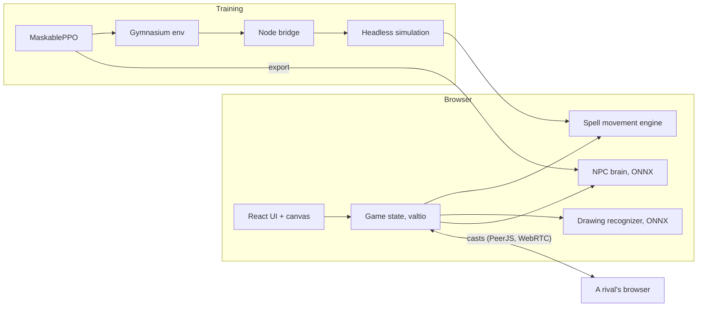

# SpellCraft

**A strategy duel where you cast spells by drawing them.**

You're a member of a masked wizard fight club. After curfew, you sneak out of bed for a duel in the school's halls. Draw spell symbols to cast them; your spells travel across the board, collide, combine and interact with your opponent's. Bring their health to zero before sunrise or the faculty are sure to catch you.

Duel a trained AI, or send a friend a link and duel them, browser to browser.

### [▶ Play it: spellcraft-game.netlify.app](https://spellcraft-game.netlify.app/)

<p align="center">
  
</p>

---

## How to play

- **Draw to cast.** Hold the mouse button and draw a spell's symbol (a circle, line, star or triangle) over your side of the board. A neural network running in your browser recognizes the drawing. The size of your drawing sets the spell's size, from one cell up to 3×3.
- **Spend focus.** Every cell of a spell costs focus. You get 3 focus back each turn and can store up to 8.
- **Or pay in blood.** Cast beyond your focus, and the difference comes out of your health instead.
- **End the turn** by clicking the clock. All spells then move and interact.
- **Mind the clock.** Its red seconds hand counts down your turn (30 seconds, ticking round faster than a real minute). If it reaches 12 before you end your turn, your turn ends anyway. Opening the Spell Book pauses it, so if you'd rather not be timed, keep it open while you think. It also waits while a tip is showing.
- **Survive until sunrise.** Each turn is twenty minutes of game time, from midnight to 6 AM. From the end of the sixth turn, a teacher may catch you at the end of any turn (1% at first, 1% likelier each turn), and surely at 6 AM. The teacher catches the weaker wizard, the one with less health: the other gets away and wins.

Mouse, keyboard or a mix of both all work; the keyboard controls are in the game's settings.

### Playing a friend

- **Invite:** after Play, choose **2 Players** and send the invite link (copy it or share it). Your friend opens it and presses **Join**; you press **Begin**. You can begin first and wait in the hall for them.
- **The duel:** each of you sees your own wizard on the left. The first move alternates every turn, and each part of a turn lasts 15 seconds.
- **Live drawings:** you see your rival's drawings as they cast. Only duel people you trust. A setting (✍️) hides them; their casts then appear as plain symbols.
- **Reactions:** in place of the difficulty mask, **React** opens a tray of eight emoji. The one you pick shows over your wizard on both screens, one every two seconds at most.
- **Rematches and drop-outs:** a rematch starts once you both agree. If a connection drops, the game waits up to a minute for your rival to come back; after that they've fled, and you win.
- The **2 Players** choice only appears when the matchmaking service can be reached.

## Game design

### Five spells, one interaction web

Every spell beats some situations and loses to others, so there's no single best spell, only the right answer to the board.

| Spell | Name in code | Symbol | Cost per cell | What it does |
|---|---|---|---|---|
| **Fireball** | `Ether` | circle | 1 | Damages on impact and destroys weaker spells. Whatever destroys it inherits +5 damage. |
| **Chain Lightning** | `Quicken` | line | 1 | Strikes for damage and destroys weaker spells; a single cell of it travels fast (+1 speed). Whatever destroys it gets a move right away for each cell of its width (that turn only; another Chain Lightning too). A single-cell one also gives a spell that destroys it +1 speed for good (once; not to a Chain Lightning). |
| **Water Wheel** | `Phlegm` | star | 1 | Heals what it touches, and reflects stronger spells back the way they came. A Water Wheel that takes in another heals +15 more. |
| **Updraft / Downdraft** | `GyreUp` / `GyreDown` | diamond / triangle | 1 | Lifts stronger spells up or down, until it has absorbed 5 damage per cell. Anything pushed off the board is destroyed. |

Because spells pass their power on, combos emerge naturally: a Fireball fed into your own spell makes it hit harder, and an Updraft or Downdraft can lift an incoming spell out of a threatened row, send your own spell on with extra moves, or push an enemy spell straight off the board.

**Water Wheels.** A sized spell that runs into a Water Wheel breaks into single cells. Each cell swirls once around the wheel, and they reassemble as they leave it.

**Updrafts and Downdrafts:**
- **Lifting:** a draft lifts stronger spells that reach it, over as many turns as it lasts.
- **Capacity:** a draft absorbs 5 damage per cell (a 1×3 draft, 15). Each spell cell it lifts uses up that cell's power, so a Fireball uses up a draft faster than a Chain Lightning. While a draft has anything left, it lifts the next spell, even one stronger than what's left. Used capacity is never restored.
- **Shrinking:** at the end of each turn, a draft shrinks to the capacity it has left (5 per cell), from its tip, so a used draft is weaker, reaches fewer rows and gives a smaller boost. Once empty, it's gone. Drafts that join add up what each has left.
- **The boost:** a spell leaving a draft gets a one-time boost of +1 move for each cell of the draft's height, used right away.
- **Drafts meeting:** the bigger draft consumes the smaller, and the smaller pushes it one row past its own tip, in the smaller's direction. Two drafts of equal size destroy each other.

**Collisions.** Equal spells destroy each other, except two Fireballs moving the same way: the one ahead absorbs the one catching up. Pieces of the same spell never destroy each other. A spell caught in a Water Wheel or a draft can still be hit and destroyed by other spells.

### Economy and balance

- **Per-cell costs** (focus × cells, rounded down), so a spell costs about the same whether you draw it at full size or place its cells one by one with the keyboard.
- **No cost cap.** The biggest casts deliberately cost more focus than you can hold, so they always involve blood magic, which keeps a fully charged 3×3 Fireball a real decision.
- **Blood magic at 5 health per missing focus point** (3 and 7 were tried), tuned against two scenarios:
  - a 3×3 Fireball (9 focus) cast with a full 8 focus costs 5 health for up to 50 damage;
  - casting the same spell every turn, on 3 regained focus, costs 30 health each time.

  Saving up for a big turn is possible, but spamming isn't.

### Fairness

The movement rules are defined from one player's side and mirrored for the other. That covers the order spells resolve in, how sized spells break apart, and how rounding falls. The tests check that mirrored boards play out as exact mirror images: 1,000 random boards and 200 full games.

Two-player duels rely on the same determinism. Each browser runs the engine itself, mirrored, and after every turn the two compare a fingerprint of their boards; a duel that falls out of step ends ("Out of Step"). The teacher's catch is rolled from a seed both share, so both see the same result.

### The opponent

- **A trained AI:** the NPC is a reinforcement-learning agent (see below) that won all 200 of its evaluation games against scripted and random opponents. It learned with the turn order alternating, as in the game: on the turns it moves second, it sees your casts before answering.
- **Variety:** rather than always playing its top-rated move, it samples among its good moves, with a penalty for repeating a recent move (the same spell at the same size), so it doesn't fall into the same opening every game.
- **Difficulty:** Normal, Hard and Brutal mix in more or fewer random turns. Their drawings are deliberately imperfect, like a human's, but always true to the size of the spell cast, and never stretched too far out of shape.
- **No self-destruction:** casts whose blood magic would kill the NPC are removed from its legal moves, both in training and in play.
- **Turn order:** the first move alternates every turn. On odd turns (the first, the third...) the NPC waits for you to cast first, then answers; on even turns it goes first. If it's waiting too long, a tip reminds you it's your move.

## Technical highlights

- **Drawing recognition in the browser:** a small neural network, run with ONNX Runtime Web, classifies each drawing into a spell symbol.
- **A deterministic spell engine:** all movement and collision rules live in one pure, testable engine, shared by the game (which replays its frames as animation) and a headless simulation.
- **An NPC trained with reinforcement learning:**
  - the headless simulation is wrapped as a [Gymnasium](https://gymnasium.farama.org/) environment through a Node bridge;
  - it's trained with MaskablePPO ([Stable-Baselines3](https://sb3-contrib.readthedocs.io/)), which never picks illegal moves, against a mix of scripted and random opponents;
  - it's exported to ONNX and runs in the browser.
- **Peer-to-peer multiplayer:**
  - browsers connect directly over WebRTC data channels ([PeerJS](https://peerjs.com/)), with no game server of their own;
  - only casts (and the strokes of live drawings) are sent; each browser plays them out with its own engine;
  - heartbeats spot a dropped connection, the guest reconnects on its own, and messages are held until they're delivered.
- **Procedural visuals:** spells, particles, the animated loading-screen logo (two duelists locked in a struggle, solved with two-bone inverse kinematics) and the clock's halo are all drawn in code on canvas, SVG and CSS.
- **Fast first load:**
  - a boot screen embedded in the HTML, with a title font cut down to 5 KB, shows on the first paint;
  - assets load in two batches, the logo's first;
  - the ONNX runtime loads on demand.
- **Tests:** Vitest covers the rules engine, the simulation, the training environment and the scripted opponent.



## Built with

| | |
|---|---|
| **Game** | React 19, TypeScript, Vite, styled-components, valtio |
| **Multiplayer** | PeerJS (WebRTC) |
| **Machine learning** | ONNX Runtime Web; Python, PyTorch, Gymnasium, Stable-Baselines3 (sb3-contrib) |
| **Testing and tooling** | Vitest, Oxlint, Rolldown (the training bridge), Pillow (asset scripts) |
| **Hosting** | Netlify |

## How it was made

SpellCraft is my own project: I designed it, made its art and built it over about three months. Along the way I used AI coding assistants ([Claude Code](https://claude.com/claude-code) and Gemini) as part of my workflow, for implementation support, refactoring, testing and tooling. The game's design, art and direction are my own.

## Running locally

```bash
npm install
npm run dev     # the game at http://localhost:5173
npm test        # the rules engine and simulation tests
npm run build   # a production build in dist/
```

**Training the NPC (optional):** this needs Python 3.12. Create the environment in `training/.venv` from `training/requirements.txt`, then:

```bash
npm run build:bridge                                         # bundle the simulation for Python
training/.venv/Scripts/python training/train.py --steps 500000
training/.venv/Scripts/python training/export_onnx.py training/models/<model>.zip   # use it in the game
```

## Credits

**Art:** all game art is my own.

**Font:** [Enchanted Land](https://www.sharkshock.net/) by Dennis Ludlow (Sharkshock), free for personal use (see `public/fonts/readme.txt`).

**Sound effects:** from [Freesound](https://freesound.org/), used under their Creative Commons licenses:

| Sound | Author | License |
|---|---|---|
| [CLOCKChim, Grandfather Clock, Third Quarter Chimes](https://freesound.org/s/805325/) | designerschoice | [CC BY 4.0](https://creativecommons.org/licenses/by/4.0/) |
| [Fire - Swooshes - Wind 05](https://freesound.org/s/671309/) | GregorQuendel | [CC BY-NC 4.0](https://creativecommons.org/licenses/by-nc/4.0/) |
| [Fire - Impacts - Complex 20](https://freesound.org/s/671312/) | GregorQuendel | [CC BY-NC 4.0](https://creativecommons.org/licenses/by-nc/4.0/) |
| [SFX_MAGIC_FIREBALL_001](https://freesound.org/s/77691/) | JoelAudio | [CC BY 4.0](https://creativecommons.org/licenses/by/4.0/) |
| [a gust of wind blowing some leaves](https://freesound.org/s/711441/) | F3ather | [CC0](https://creativecommons.org/publicdomain/zero/1.0/) |
| [REYNAS_Fanny_2019_2020_Water](https://freesound.org/s/485796/) | univ_lyon3 | [CC BY 4.0](https://creativecommons.org/licenses/by/4.0/) |
| [JacobsLadderSingle2](https://freesound.org/s/19487/) | Halleck | [CC BY 4.0](https://creativecommons.org/licenses/by/4.0/) |
| [Male Death Cry 3](https://freesound.org/s/695386/) | F.M.Audio | [CC BY 4.0](https://creativecommons.org/licenses/by/4.0/) |
| [Scream - Ugh](https://freesound.org/s/338145/) | ArtOrDie | [CC BY 4.0](https://creativecommons.org/licenses/by/4.0/) |
| [Male Grunts](https://freesound.org/s/727827/) | abraksil | [CC0](https://creativecommons.org/publicdomain/zero/1.0/) |
| [Magic Healing Spell SFX - Fantasy RPG Restore Effect](https://freesound.org/s/853303/) | TommasoMotteran | [CC BY 4.0](https://creativecommons.org/licenses/by/4.0/) |

**Music:** "Magic Escape Room" Kevin MacLeod ([incompetech.com](https://incompetech.com/))\
Licensed under Creative Commons: By Attribution 4.0 License\
[http://creativecommons.org/licenses/by/4.0/](http://creativecommons.org/licenses/by/4.0/)

## License

The code is released under the [MIT License](LICENSE). The art, sounds, music and font are not covered by it; they belong to their creators, under the terms above.
